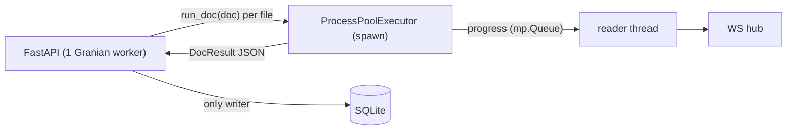

# Backend

## Pipeline (`backend/pipeline`)

Standalone, no web dependencies. `build_pipeline()` in `__init__.py` assembles the default steps:

| Step | Class | Reads | Writes |
|---|---|---|---|
| `raw` | `ImgExtractor` | input PDF | `raw/pNNN.jpg` |
| `cropped` | `TableExtractor` | `raw/` | `cropped/pNNN.jpg`, `cropped/pNNN.geom.json`, `cropped/outlines/`, optional `cropped/grid/` |
| `processed` | `LlmExtractor` | `cropped/` | `processed/pNNN.json` (`ExtractionResult`), `processed/pNNN.md` |
| `ocr` (optional) | `OcrExtractor` | `cropped/` | `ocr/pNNN.md`. Needs the `ocr` group (vLLM); imported lazily. |

- `PipelineTask` describes one PDF: output folder, optional page filter and `on_progress(step, page, pages)` callback.
- `Pipeline.run(task, only=[...])` returns a `DocResult`: per page, the geometry and the LLM `PageTable`.

**Geometry** (`PageGeometry`) is in pixels of the cropped image:
- `header`: (y0, y1) of the header row
- `row_bounds[n-1]`: (y0, y1) of data row *n*
- `col_bounds`: x of every vertical grid line (12 lines for the 11 printed columns)

Lines closer than 0.75 × the median row height are dropped (`drop_spurious_lines`). This catches crossed-out rows and underlined handwriting.

## Web app (`backend/api`)

| Module | Purpose |
|---|---|
| `app.py` | FastAPI app, lifespan (DB + pool), `/api` router, SPA fallback |
| `config.py` | `Settings` (env prefix `WEB_`) |
| `db.py`, `models.py` | async SQLite (WAL) + SQLModel tables `Batch`, `Doc`, `Page`, `Row`, `Flag` |
| `schemas.py`, `enums.py` | every request/response + WS event model |
| `processing.py` | process pool orchestration, persistence, events |
| `worker.py` | code that runs inside pool processes (pipeline only) |
| `flags.py` | LLM uncertainties + plausibility rules → flags |
| `queries.py` | shared read helpers / schema builders |
| `storage.py` | `ArtifactStore`, the only owner of absolute paths, plus Nextcloud hook points |
| `auth.py` | `current_user` dependency (local user for now) |
| `hub.py`, `routes/` | WebSocket fan-out, HTTP routes |

### Processing

- One job per document. At most `WEB_POOL_SIZE` documents run in parallel; each worker builds the pipeline once.
- After a job, the main process replaces the doc's pages, rows and flags. The status becomes `review` (open flags), `done`, or `error`.
- On startup, docs left in `processing` are re-queued.

### Data rules

- `Row.values` holds the machine output and is never changed. Human edits go to `Row.corrections`. The API always returns the merged values.
- Resolving is per row: `POST /api/docs/{slug}/page/{num}/rows/{idx}/resolve` stores the changed cells and resolves every open flag of that row. A value equal to the machine value removes the correction, so sending a row's previous values restores it exactly (that is how undo works).
- `Doc.open_flags` and `Doc.status` (`review` ⇄ `done`) are recomputed by `queries.refresh_doc_flags` after every flag change.
- `processed` artifacts are rendered from the DB, so the markdown includes corrections.
- `PageRows.column_x` maps each column key to its x-range in the cropped image (`additional_remark` spans the last 3 printed columns). See `COLUMN_GRID_SPAN` in `enums.py`.

### Flags

| Source | Created from | Fields |
|---|---|---|
| `llm` | every `Uncertainty` with a row number. The printed header (e.g. "Espèce") is mapped to a column key in `flags.HEADER_KEYS`. | `message` = reason, `suggestion` = best guess, `confidence`, `params.value` = value read |
| `rule` | non-empty cells: `not_a_number`, `weight_out_of_range` (2–2000 g), `wing_out_of_range` (20–700 mm), `time_format` (H:MM) | `code` + `params` for the frontend translations, English `message` fallback |
| `user` | a reviewer note via `POST /docs/{slug}/flags`, on any processed row, optionally tied to one column | `message` = comment, `severity` (default `warning`) |

All three are resolved the same way (per row). Differences:
- **Delete:** only `user` flags can be deleted (`DELETE`; anything else returns `409`).
- **Undo:** any resolved flag can be reopened (`POST /docs/{slug}/flags/reopen`).
- **Done docs:** adding a note to a `done` doc moves it back to `review`.
- **Reprocessing:** reprocessing a doc replaces all of its flags, notes included.

### API

All routes are under `/api`. OpenAPI is at `/docs` and `/openapi.json`. The WS event types are published via `GET /api/ws/schema`.

| Method | Path | Response |
|---|---|---|
| POST | `/batches` (multipart `name`, `files[]`, PDF only) | `BatchOut` · 409 `DuplicateFiles` · 413 · 422 |
| GET | `/batches?page&size` | `Paginated[BatchOut]` |
| GET | `/batches/{slug}` · `/batches/{slug}/docs?page&size` | `BatchOut` · `Paginated[DocOut]` |
| GET | `/docs/{slug}` · `/docs/{slug}/flags?open=` | `DocDetail` · `list[FlagOut]` |
| GET | `/docs/{slug}/page/{num}/rows` | `PageRows` · 404 if the page is not processed |
| POST | `/docs/{slug}/page/{num}/rows/{idx}/resolve` (body `RowUpdate`) | `ResolveOut` |
| POST | `/docs/{slug}/flags` (body `FlagCreate`) | 201 `FlagChangeOut` · 404 unknown row · 409 doc not processed |
| DELETE | `/docs/{slug}/flags/{id}` | `FlagChangeOut` · 409 if not a `user` flag |
| POST | `/docs/{slug}/flags/reopen` (body `FlagIds`) | `FlagChangeOut` · 404 if an id is unknown |
| GET | `/docs/{slug}/artifacts/{raw\|cropped\|processed}/page/{num}` | JPEG / markdown |
| GET | `/review?batch=` / `?doc=` | `ReviewQueue` |
| GET | `/health` | `Health` |
| WS | `/ws` | `doc.status`, `batch.created`, `batch.updated`, `review.pending` (also sent on connect) |

Every write that changes flags broadcasts `doc.status`, `batch.updated` and `review.pending`.

### Schemas (`schemas.py`)

Enums (`enums.py`):

| Enum | Values |
|---|---|
| `DocStatus` | `queued`, `processing`, `review`, `done`, `error` |
| `ArtifactState` | `raw`, `cropped`, `processed` |
| `ColumnKey` | `ring_no`, `species`, `sex`, `age`, `date`, `time`, `wing_length_mm`, `weight_g`, `additional_remark` |
| `FlagSource` | `llm`, `rule`, `user` |
| `Severity` | `error`, `warning` |

Responses:

| Schema | Fields |
|---|---|
| `Paginated[T]` | `items: T[]`, `total`, `page` (1-based), `size` |
| `StatusCounts` | `queued`, `processing`, `review`, `done`, `error` (doc counts) |
| `BatchOut` | `slug`, `name`, `created_at`, `num_docs`, `counts: StatusCounts`, `open_flags` |
| `DocOut` | `slug`, `batch_slug`, `filename`, `status: DocStatus`, `num_pages?`, `open_flags`, `error?`, `updated_at` |
| `PageInfo` | `num`, `open_flags`, `page_confidence?` |
| `DocDetail` | `DocOut` + `batch_name`, `pages: PageInfo[]`, `artifact_url` (template with `{state}`, `{num}`) |
| `RowOut` | `idx` (1-based), `y0`, `y1` (px in the cropped image), `values: {ColumnKey: str}` (effective), `corrected: ColumnKey[]` |
| `PageRows` | `num`, `width`, `height` (cropped image), `columns: ColumnKey[]`, `column_x: {ColumnKey: [x0, x1]}`, `rows: RowOut[]` |
| `FlagOut` | `id`, `page`, `row`, `column?`, `source`, `severity`, `code?`, `params: {str: str\|float}`, `message`, `suggestion?`, `confidence?`, `resolved` |
| `ResolveOut` | `doc: DocOut`, `resolved_flag_ids: int[]` |
| `FlagChangeOut` | `doc: DocOut`, `flags: FlagOut[]` (created / reopened; empty on delete) |
| `DuplicateFiles` (409) | `detail: "duplicate_files"`, `filenames: str[]` |
| `ReviewItem` | `slug`, `batch_slug`, `filename`, `open_flags` |
| `ReviewQueue` | `scope: all\|batch\|doc`, `files_left`, `flags_left`, `docs: ReviewItem[]` (oldest batch first, then filename) |
| `Health` | `status: "ok"` |

Requests:

| Schema | Fields |
|---|---|
| upload (multipart) | `name: str`, `files: File[]` (PDF) |
| `RowUpdate` | `values: {ColumnKey: str}`, changed cells only; `{}` = accept the machine values |
| `FlagCreate` | `page`, `row`, `column?` (null = whole row), `message` (1–2000 chars), `severity` = `warning` |
| `FlagIds` | `ids: int[]` (at least 1) |

WebSocket events (server → client, discriminated by `type`; JSON schema at `GET /api/ws/schema`):

| `type` | Payload |
|---|---|
| `doc.status` | `doc: DocOut`, `progress?: {step: ArtifactState, page, pages}` (only while `processing`) |
| `batch.created` / `batch.updated` | `batch: BatchOut` |
| `review.pending` | `files_left`, `flags_left` (global) |

### Database (`models.py`)

SQLite (WAL) at `WEB_DB_PATH`. Tables are created with `create_all`, so adding a column needs a manual migration (or Alembic) on existing DBs. Paths are stored relative to the artifact root.

| Table | Columns |
|---|---|
| `Batch` | `id`, `slug` (unique), `name`, `owner?`, `created_at` |
| `Doc` | `id`, `slug` (unique), `batch_id`, `filename` (unique per batch), `status`, `num_pages?`, `open_flags` (denormalised), `error?`, `created_at`, `updated_at` |
| `Page` | `id`, `doc_id`, `num` (unique per doc), `width`, `height`, `col_bounds: int[]` (JSON), `page_confidence?` |
| `Row` | `id`, `page_id`, `idx` (unique per page), `y0`, `y1`, `values` (JSON, machine), `corrections` (JSON, human) |
| `Flag` | `id`, `doc_id`, `page_num`, `row_idx`, `column?`, `source`, `severity`, `code?`, `params` (JSON), `message`, `suggestion?`, `confidence?`, `resolved` |

`Page`, `Row` and `Flag` cascade on delete with their doc.

## Configuration

| Env | Default | Docker |
|---|---|---|
| `WEB_DATA_DIR` | `./data` | `/data` |
| `WEB_DB_PATH` | `<data>/state/app.db` | |
| `WEB_FRONTEND_DIR` | `frontend/dist/browser` | `/app/static` |
| `WEB_POOL_SIZE` | `2` | |
| `WEB_MAX_UPLOAD_MB` | `200` (per file) | |
| `LLM_BASE_URL`, `LLM_API_KEY`, `LLM_MODEL_NAME`, `LLM_REASONING_EFFORT`, `STEP_CONCURRENCY` | `.env` | env |
| `LLM_PROMPT_FILE` | `data/prompts/llm_prompt.txt` | `/app/prompts/llm_prompt.txt` |

## Later: auth + Nextcloud

- `auth.current_user` is already a dependency of every batch, doc and review route. A Nextcloud login (username + app password checked via OCS, then an HttpOnly session cookie) only needs to replace it. `Batch.owner` is stored.
- `ArtifactStore.after_upload / after_processing / after_review` are the sync hook points. The artifact tree `batches/<batch>/<doc>/` is self-contained and can be mirrored 1:1. The DB in `state/` stays local.
