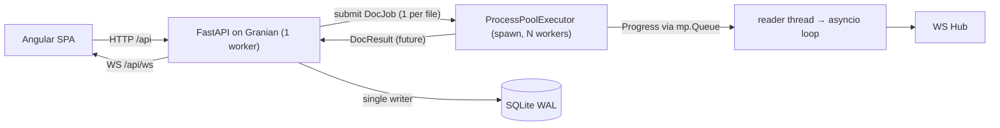

# DocDig – Rework Proposal

Status: **v2, decisions included, waiting for final OK**. Nothing here is implemented yet.
Source: `frontend.md`, answers to v1, and a review of the current code (`backend/`, `frontend/src/app`).

---

## 0. Current state (what I found)

| Area | Today | Problem |
|---|---|---|
| Frontend | One `Store` with mock data. `App` switches views with a signal. Router is empty. All components sit flat in `src/app`. | No real API calls, no routing, not modular. |
| API (`backend/api/web.py`) | Sync FastAPI + plain SQLAlchemy. Untyped dict responses. `/artifacts/{path}` serves any file. | `Batch.from_folder` is used but missing in `db.py`, so it crashes. No pagination. No schemas. |
| Worker (`backend/api/worker.py`) | Separate process that polls SQLite and sends events back over HTTP `/internal/events`. | Replace with a process pool and a pipe. |
| Result adapter (`result.py`) | Reads `result.json` with 7 mock columns. | The LLM step writes `llms/<provider>/<model>/<page>.json` with 9 different columns, so the adapter never finds data. |
| Pipeline | `imgs/` → `table/` → `llms/…`. TableExtractor only writes images. LlmExtractor calls `sys.exit(1)` on refusal. | No row geometry. `sys.exit` would kill a pool worker. |
| Pipeline imports | `steps/__init__.py` imports `OcrExtractor`, which imports `vllm`. | Every pipeline import pulls in vLLM. That is a problem for Docker image size. |
| Doc model | One uploaded file = one `Doc`, named `…-p001` as if it were one page. | Files usually have several pages, so we need a real `Page` level. |

---

## 1. Decisions (from v1)

| # | Topic | Decision |
|---|---|---|
| 1 | Clickable files | `review` → review queue, `done` → detail page. `queued`, `processing` and `error` are not clickable. |
| 2 | Row highlight | Step 2 (cropped) only. When a record gets selected (clicked, or reached via *Save & next* / *Skip*), the viewer **switches to step 2 automatically** and highlights the row. |
| 3 | Resolve | Per **row**: saving a record resolves all open flags on that row. |
| 4 | Rules | Numeric and time checks plus LLM uncertainties, for now. |
| 5 | i18n | Frontend only (de/fr/en). |
| 6 | OCR (vLLM) | Left out. It becomes an optional extra, see §6. |
| 7 | Auth | Not implemented yet. The structure is ready for username/password login against Nextcloud, see §8. |
| – | Branch | We stay on `main`. The pipeline stays runnable on its own (`main.py` + CLI, §6), with no web stack involved. |

---

## 2. Domain model

```
Batch 1─n Doc (= one uploaded PDF) 1─n Page (= one scanned sheet / one table) 1─n Row (= one record)
                                                     Doc 1─n Flag  (each flag points to page + row [+ column])
```

**Columns** (fixed, from `TableRow`): `ring_no, species, sex, age, date, time, wing_length_mm, weight_g, additional_remark`.
The API uses these keys and the frontend owns the translated labels.

**Doc status:** `queued → processing → review | done | error`

---

## 3. Database (SQLModel, async via `aiosqlite`)

```python
class Batch(SQLModel, table=True):
    id: int | None = Field(default=None, primary_key=True)
    slug: str = Field(unique=True, index=True)          # 20261028-mettnau
    name: str
    owner: str | None = None                            # username once auth exists (§8)
    created_at: datetime

class Doc(SQLModel, table=True):
    id: int | None = Field(default=None, primary_key=True)
    slug: str = Field(unique=True, index=True)          # 20261028-mettnau-scan-01
    batch_id: int = Field(foreign_key="batch.id", index=True)
    filename: str                                       # unique within a batch
    status: DocStatus = DocStatus.queued
    num_pages: int | None = None
    open_flags: int = 0                                 # denormalised for lists
    error: str | None = None
    created_at: datetime
    updated_at: datetime

class Page(SQLModel, table=True):
    id: int | None = Field(default=None, primary_key=True)
    doc_id: int = Field(foreign_key="doc.id", index=True)
    num: int                                            # 1-based
    width: int; height: int                             # cropped image size
    col_bounds: list[int] = Field(sa_column=Column(JSON))
    page_confidence: float | None = None

class Row(SQLModel, table=True):
    id: int | None = Field(default=None, primary_key=True)
    page_id: int = Field(foreign_key="page.id", index=True)
    idx: int                                            # 1-based data row (header not counted)
    y0: int; y1: int                                    # bounds in the cropped image
    values: dict[str, str] = Field(sa_column=Column(JSON))                             # machine output, never overwritten
    corrections: dict[str, str] = Field(default_factory=dict, sa_column=Column(JSON))  # human edits

class Flag(SQLModel, table=True):
    id: int | None = Field(default=None, primary_key=True)
    doc_id: int = Field(foreign_key="doc.id", index=True)
    page_num: int; row_idx: int
    column: ColumnKey | None = None
    source: Literal["llm", "rule"]
    severity: Literal["error", "warning"]
    code: str | None = None                             # rule flags: i18n key
    params: dict = Field(default_factory=dict, sa_column=Column(JSON))
    message: str                                        # ONE text
    suggestion: str | None = None
    confidence: float | None = None
    resolved: bool = False
```

- The effective value of a cell is `values | corrections`.
- The DB stores only **relative** artifact paths (`batches/<batch>/<doc>/…`), so the storage root can move. This matters for Docker and Nextcloud.
- No Alembic yet. The existing `app.db` is wiped.

---

## 4. API (all under `/api`, every response is a Pydantic model)

| Method | Path | Request | Response |
|---|---|---|---|
| POST | `/api/batches` | multipart: `name`, `files[]` (PDF only, streamed to disk in chunks) | `201 BatchOut` · `409 DuplicateFiles` · `422` |
| GET | `/api/batches?page=1&size=10` | – | `Paginated[BatchOut]`, newest first |
| GET | `/api/batches/{slug}` | – | `BatchOut` |
| GET | `/api/batches/{slug}/docs?page=1&size=10` | – | `Paginated[DocOut]` |
| GET | `/api/docs/{slug}` | – | `DocDetail` |
| GET | `/api/docs/{slug}/flags?open=true` | – | `list[FlagOut]` |
| GET | `/api/docs/{slug}/page/{num}/rows` | – | `PageRows` (boxes **and** effective values) |
| POST | `/api/docs/{slug}/page/{num}/rows/{idx}/resolve` | `RowUpdate` | `ResolveOut` |
| GET | `/api/docs/{slug}/artifacts/{state}/page/{num}` | `state = raw \| cropped \| processed` | `image/jpeg` (streamed) or `text/markdown` (built from the DB, including corrections) |
| GET | `/api/review` · `?batch={slug}` · `?doc={slug}` | – | `ReviewQueue` |
| GET | `/api/health` | – | `{"status": "ok"}` (Docker healthcheck) |
| WS | `/api/ws` | server → client only | `ServerEvent` |

### Schemas

```python
class Paginated[T](BaseModel):
    items: list[T]; total: int; page: int; size: int

class StatusCounts(BaseModel):
    queued: int = 0; processing: int = 0; review: int = 0; done: int = 0; error: int = 0

class BatchOut(BaseModel):
    slug: str; name: str; created_at: datetime
    num_docs: int; counts: StatusCounts; open_flags: int

class DocOut(BaseModel):
    slug: str; batch_slug: str; filename: str
    status: DocStatus; num_pages: int | None; open_flags: int
    error: str | None; updated_at: datetime

class PageInfo(BaseModel):
    num: int; open_flags: int; page_confidence: float | None

class DocDetail(DocOut):
    batch_name: str
    pages: list[PageInfo]
    artifact_url: str        # "/api/docs/{slug}/artifacts/{state}/page/{num}"

class RowOut(BaseModel):
    idx: int; y0: int; y1: int
    values: dict[ColumnKey, str]          # effective
    corrected: list[ColumnKey]

class PageRows(BaseModel):
    num: int; width: int; height: int     # SVG overlay viewBox
    columns: list[ColumnKey]
    col_bounds: list[int]                 # cell (r, c) = x∈[col_bounds[c], col_bounds[c+1]], y∈[y0, y1]
    rows: list[RowOut]

class FlagOut(BaseModel):
    id: int; page: int; row: int; column: ColumnKey | None
    source: Literal["llm", "rule"]; severity: Literal["error", "warning"]
    code: str | None; params: dict[str, str | float]
    message: str; suggestion: str | None; confidence: float | None
    resolved: bool

class RowUpdate(BaseModel):
    values: dict[ColumnKey, str] = {}     # changed cells only; empty = accept machine values

class ResolveOut(BaseModel):
    doc: DocOut; resolved_flag_ids: list[int]

class DuplicateFiles(BaseModel):
    detail: Literal["duplicate_files"]; filenames: list[str]

class ReviewItem(BaseModel):
    slug: str; batch_slug: str; filename: str; open_flags: int

class ReviewQueue(BaseModel):
    scope: Literal["all", "batch", "doc"]
    files_left: int; flags_left: int
    docs: list[ReviewItem]                # oldest batch first, then filename
```

### WebSocket events

```python
class Progress(BaseModel):
    step: ArtifactState; page: int; pages: int

class DocEvent(BaseModel):
    type: Literal["doc.status"]; doc: DocOut; progress: Progress | None = None

class BatchEvent(BaseModel):
    type: Literal["batch.created", "batch.updated"]; batch: BatchOut

class ReviewEvent(BaseModel):              # also sent once on connect
    type: Literal["review.pending"]; files_left: int; flags_left: int

ServerEvent = Annotated[DocEvent | BatchEvent | ReviewEvent, Field(discriminator="type")]
```

TS types are generated from `/openapi.json` with `openapi-typescript`. The output is committed and regenerated with `npm run gen:api`.

---

## 5. Processing architecture



- **Unit of work = one file.** Batches are split into files and spread across the pool. Each worker builds the pipeline once in its `initializer`.
- Workers **never touch the DB.** They write artifacts and return a `DocResult`. Progress goes over an `mp.Queue`, and a reader thread forwards it to the event loop.
- The main process is the only DB writer. It persists pages, rows and flags, then emits WS events.
- On startup, docs stuck in `processing` go back to `queued` and are resubmitted.
- Granian runs with `--workers 1`. Each Granian worker would start its own pool, so the pool provides the parallelism (`WEB_POOL_SIZE`, default 2).
- Removed: `worker.py`, `/internal/events`, `api_url`, `internal_token`.

```python
class DocJob(BaseModel):      # main → worker
    doc_id: int; input_pdf: FilePath; out_dir: DirectoryPath

class PageResult(BaseModel):  # worker → main
    num: int; width: int; height: int
    col_bounds: list[int]; row_bounds: list[tuple[int, int]]
    table: PageTable          # existing LLM schema

class DocResult(BaseModel):
    doc_id: int; pages: list[PageResult]
```

**Flags** (`backend/api/flags.py`, replaces `result.py`):
- every LLM `Uncertainty` → `source="llm"`, `message=reason`, `suggestion=best_guess`, `confidence`
- rules → `source="rule"` + `code`/`params`: weight and wing are numeric and in range, time is `HH:MM`

---

## 6. Pipeline (stays standalone, so you can keep experimenting)

The pipeline package has **no dependency on the web stack** (no DB, FastAPI or SQLModel). The web app is just one more caller.

### Changes

- Output folders match the API states:

  ```
  <out>/<doc>/raw/p001.jpg
             /cropped/p001.jpg       (+ cropped/outlines/p001.jpg for debugging)
             /cropped/p001.geom.json (col_bounds, row_bounds, width, height)
             /processed/p001.json    (ExtractionResult)
             /processed/p001.md
  ```

- **TableExtractor** also returns `col_bounds` and data-row `(y0, y1)` pairs, with the header row skipped. These are written to `p001.geom.json` too, so CLI runs give you the geometry as well. I'll check the header handling on `data/input/scan.pdf`.
- Each step can run on its own: it reads its input from the previous step's folder **on disk**. That means you can rerun only `cropped` + `processed` after tweaking the table detection.
- `PipelineTask` gets an optional `on_progress(step, page, pages)` callback. It is a no-op in the CLI.
- `run()` returns a `DocResult`, which is what the web app persists.
- LlmExtractor raises an exception instead of calling `sys.exit(1)`.
- `OcrExtractor` is imported lazily, and `vllm` moves to an optional extra (`uv sync --extra ocr`).

### Playground

`backend/main.py` keeps working as it does today (`data/input/*` → `data/output/`), using the new code. On top of that:

```bash
# whole pipeline on one or more PDFs
uv run python -m backend.pipeline run data/input/scan.pdf -o data/output

# only some steps, reusing what's already on disk
uv run python -m backend.pipeline run data/input/scan.pdf -o data/output --steps cropped,processed

# one page only, and render the geometry overlay for a visual check
uv run python -m backend.pipeline run data/input/scan.pdf -o data/output --page 2 --steps cropped --draw-rows
```

`--draw-rows` writes `cropped/rows/p002.jpg` with the detected row and column boxes drawn on top. This lets you check the geometry without the frontend.

---

## 7. Backend layout, config, embedding

```
backend/
  main.py                 playground entry (as today)
  pipeline/               standalone package (+ __main__.py CLI)
  api/
    app.py                FastAPI app, lifespan, static mount
    config.py             Settings (WEB_ prefix)
    db.py                 async engine/session, init
    models.py             SQLModel tables
    schemas.py            request/response + WS events
    flags.py
    processing.py         pool, dispatch, progress reader, persistence
    storage.py            ArtifactStore (local now; Nextcloud sync later, §8)
    auth.py               current_user dependency (anonymous now, §8)
    hub.py
    routes/ batches.py  docs.py  review.py  ws.py  health.py
```

- Async endpoints, `AsyncSession`, uploads written in 1 MB chunks with `anyio`, images returned as streamed `FileResponse`.
- **Embedded frontend:** FastAPI mounts the Angular build from `WEB_FRONTEND_DIR`. Unknown non-`/api` paths fall back to `index.html`. In dev, Angular's `proxy.conf.json` forwards `/api` and the WS to `:8000`.
- Dependencies: add `sqlmodel`, `aiosqlite`. Switch to `opencv-python-headless` (no GUI calls are used). Move `vllm` to `[project.optional-dependencies] ocr`. Drop `nest-asyncio`.

### Settings: all paths configurable (needed for Docker)

| Env | Default (local) | Docker |
|---|---|---|
| `WEB_DATA_DIR` | `./data` | `/data` |
| `WEB_DB_PATH` | `$WEB_DATA_DIR/state/app.db` | `/data/state/app.db` |
| `WEB_FRONTEND_DIR` | `frontend/dist/frontend/browser` | `/app/static` |
| `WEB_POOL_SIZE` | `2` | `2` |
| `LLM_PROMPT_FILE` | `data/prompts/llm_prompt.txt` | `/app/prompts/llm_prompt.txt` (override by mounting) |
| `LLM_BASE_URL`, `LLM_API_KEY`, `LLM_MODEL_NAME`, … | `.env` | env / secrets |

`PROJECT_ROOT` detection (looks for `pyproject.toml`) only provides the defaults. In the container, everything comes from env.

---

## 8. Ready for auth + Nextcloud (structure only, nothing implemented)

**Volume layout.** State and artifacts are split, so artifacts can later be synced 1:1:

```
/data
  state/app.db                          local only, never synced
  batches/<batch>/<doc>/input/*.pdf     ┐
                        raw/ cropped/   ├ artifact tree; later mirrored to Nextcloud
                        processed/      ┘
```

**`ArtifactStore`** (`storage.py`) is the only code that knows the absolute root. Every other module passes relative paths. Today it is the local filesystem. Later, a `NextcloudSync` adds two jobs:
- push `batches/<batch>/<doc>/` after processing or resolving
- pull input PDFs from a Nextcloud folder

These are hooks, not a filesystem replacement: OpenCV and pdf2image keep working on local files.

**Auth hook** (`auth.py`):
- All routers depend on `current_user`. For now it returns `User(name="local")`.
- Later: `POST /api/auth/login` (Nextcloud username + app password, checked against Nextcloud OCS) sets an HttpOnly session cookie. The credentials are kept server-side for WebDAV. `Batch.owner` is already in the schema.

**Frontend slots:** `core/auth/` gets an empty interceptor and a route guard, plus a `/login` route that stays unregistered for now.

---

## 9. Docker

Multi-stage, one image, everything stateful on volumes:

```dockerfile
# 1) frontend build
FROM node:22-alpine AS web
WORKDIR /web
COPY frontend/package*.json ./
RUN npm ci
COPY frontend/ .
RUN npm run build

# 2) python deps (uv, no ocr extra)
FROM python:3.12-slim AS py
COPY --from=ghcr.io/astral-sh/uv:latest /uv /bin/uv
WORKDIR /app
COPY pyproject.toml uv.lock ./
RUN uv sync --frozen --no-dev --no-install-project

# 3) runtime
FROM python:3.12-slim
RUN apt-get update && apt-get install -y --no-install-recommends poppler-utils \
 && rm -rf /var/lib/apt/lists/* && useradd -u 1000 -m docdig
WORKDIR /app
COPY --from=py /app/.venv /app/.venv
COPY backend/ backend/
COPY data/prompts/ prompts/
COPY --from=web /web/dist/frontend/browser static/
ENV PATH=/app/.venv/bin:$PATH \
    WEB_DATA_DIR=/data WEB_FRONTEND_DIR=/app/static \
    LLM_PROMPT_FILE=/app/prompts/llm_prompt.txt
VOLUME /data
USER docdig
EXPOSE 8000
HEALTHCHECK CMD python -c "import urllib.request;urllib.request.urlopen('http://127.0.0.1:8000/api/health')"
CMD ["granian", "--interface", "asgi", "--host", "0.0.0.0", "--port", "8000", "--workers", "1", "backend.api.app:app"]
```

Plus a `compose.yaml` with a named volume `docdig-data:/data` and `env_file: .env`, and a `.dockerignore` that excludes `data/`, `models/`, `.venv`, `node_modules` and `frontend/dist`.

---

## 10. Frontend

### Routes (lazy-loaded)

| Path | Page |
|---|---|
| `/` | Batches (home) |
| `/review` | Review queue, all batches, oldest first |
| `/review/batch/:batchSlug` | Review queue for one batch |
| `/review/file/:docSlug` | Review a single file |
| `/:docSlug` | Detail page, read-only 3-step view |

On the home page, files open the review queue or the detail page as in decision 1. The batch header opens `/review/batch/:slug`.

### Structure

```
src/app/
  core/
    api/        api.service.ts (httpResource), api.types.ts (generated)
    realtime/   ws.service.ts (reconnect, signals, invalidates resources)
    i18n/       translate.service.ts, t.pipe.ts, de.ts, fr.ts, en.ts
    theme/      theme.service.ts (system | light | dark)
    auth/       interceptor + guard (empty placeholders, §8)
  layout/       shell.ts, top-bar.ts
  features/
    batches/    batches-page.ts, batch-card.ts, upload-dialog.ts
    review/     review-page.ts, review-header.ts, flagged-records.ts, record-editor.ts
    document/   document-page.ts
  shared/
    ui/         pipeline-viewer.ts, page-selector.ts, paginator.ts, status-badge.ts,
                result-table.ts, empty-state.ts, file-size.pipe.ts
    core/, utils/   (existing zard code, untouched)
```

The mock `store.ts`, the placeholder `app.html` and the watched-folder UI are removed.

### Pages

- **Top bar:** Vogelwarte logo and "DocDig" on the left. On the right: *Review queue* with the live `flags_left` badge, a language select (de/fr/en, saved in `localStorage`) and a theme select (default: system).
- **Batches:** paginated batch list (`size=10`). Each card shows status counts and open flags and is collapsed by default. Expanding it shows its files, paginated (`size=10`). Updates arrive over the WS. *New batch* opens the upload dialog.
- **Upload dialog:**
  - Duplicate filenames are skipped with a warning. The server also returns `409`.
  - The preview list is paginated, 10 per page.
  - Sizes are shown as B / KB / MB.
  - PDF only.
- **Review** (tablet + PC). Layout: `xl` uses 3 columns (flagged records | editor | viewer). `md` (tablet) puts the viewer on the right and stacks records and the editor on the left.
  - Header: file selector (batch/all mode) and `files_left` / `flags_left`.
  - Flagged records: scrollable list, grouped by page.
  - Record editor: all 9 fields including additional remarks, then one message per flag plus a suggestion link, then *Save & next* / *Skip*. When the last flag of a file is resolved, it moves on to the next file.
  - Pipeline viewer: step toggle and page selector next to it.
    - Step 1: raw image.
    - Step 2: cropped image with an SVG row/cell highlight. No buttons.
    - Step 3: *Rendered | Markdown*, updated live as you type.
    - Selecting a record switches to its page and to **step 2** (decision 2).
  - Nothing to review: green check and "No review needed".
- **Detail** (`/:docSlug`): the same viewer, read-only.

### i18n

A signal-based `TranslateService` with typed dictionaries. A missing key is a compile error because `fr`/`en` must match the `de` type. Rule flags are translated from `code` + `params`. LLM messages are shown as returned.

---

## 11. Implementation order

1. Pipeline: folders, geometry, standalone steps, CLI, lazy OCR, no `sys.exit`. `main.py` keeps working. *(Commit 1: you can play right away.)*
2. Backend: settings, models, schemas, storage, auth hook, db
3. Processing: pool, queue, persistence, WS
4. Routes, static embedding, health
5. Frontend core: generated types, services, routing, shell, theme, i18n
6. Frontend pages: batches + upload, review, detail
7. Docker: `Dockerfile`, `compose.yaml`, `.dockerignore`
8. Docs: `README.md` (dev / playground / build / docker), `docs/backend.md`, `docs/frontend.md`. Short.

Each step is a separate commit on `main`.

---

## 12. Remaining questions

1. **Commit current state first?** The working tree has the `backend/src → backend/` move and other changes uncommitted. I'd commit those as-is ("restructure backend") before step 1, so the rework diffs stay clean. OK?
2. **Node version for the build:** `node:22` is fine for Angular 22, unless you have a pinned version.
