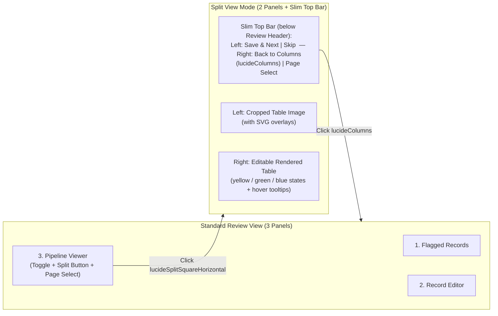

# Split View – Proposal

Status: **Draft, waiting for OK**. Nothing here is implemented yet.

---

## 1. Goal & Overview

Add a **Split View** mode to the Review Queue (`ReviewPage`) for rapid, page-level side-by-side table verification and inline editing, as an alternative to the 3-column record-by-record view.



---

## 2. Entry & Mode Switching

- **Persistent Review Header:** The top row of [`ReviewPage`](file:///home/fabi/Documents/edu/master/min1/docdig/frontend/src/app/features/review/review-page.ts) (file selector / filename on the left, `files_left` and `flags_left` counters on the right) stays visible in both Column View and Split View.
- **Trigger button (Column View → Split View):** In [`PipelineViewer`](file:///home/fabi/Documents/edu/master/min1/docdig/frontend/src/app/shared/ui/pipeline-viewer.ts) (when shown in `ReviewPage`), place a button with the `lucideSplitSquareHorizontal` (`lucideSquareSplitHorizontal` in `@ng-icons/lucide`) icon **immediately to the left of the page selector** (in the top-right area of the viewer header).
  - Note: The page selector and split-view button are rendered even on single-page documents when in review mode so the Split View toggle is always accessible.
- **Entering Split View:** Clicking the button activates `splitMode = signal(true)` on `ReviewPage`.
  - The existing 3 panels (`Flagged Records`, `Record Editor`, `Pipeline Viewer`) disappear.
  - Below the persistent Review Header, the **Split View** (`app-split-review`) is rendered, consisting of the slim top bar and the two side-by-side panes filling the remaining viewport height.
- **Exiting Split View (Split View → Column View):** Clicking the `lucideColumns` button on the right side of the slim top bar (just left of the page selector) exits Split View and returns to the 3-column layout.

---

## 3. Layout & Slim Top Bar

Directly **below the Review Header** (file selector + `files_left` / `flags_left`) and above the two side-by-side panes, a slim control bar (`py-1.5 px-3`) provides batch actions on the left and view/page controls on the right:

| Position | Element | Behaviour |
|---|---|---|
| **Left** | **Save & Next** (`Speichern & weiter`) | Saves all edited rows and resolves all flags on the **current page**, then advances to the next page with open flags (or the next file in the queue). **If the current page still has unresolved (yellow) flags**, a confirmation warning is shown first (e.g. *"Es gibt noch {n} unbestätigte Markierungen auf dieser Seite. Trotzdem speichern und alle als erledigt markieren?"*) before saving. |
| **Left** | **Skip** (`Überspringen`) | Discards any unsaved draft edits on the current page and advances to the **next page with open flags** (or the next file in the queue if no pages with open flags remain in the current document). |
| **Right** (left of Page Selector) | **Column View Button** (`lucideColumns`) | Switches back from Split View to the 3-column review layout. |
| **Right** | **Page Selector** (`Seite 1 (3)`) | Dropdown of all pages in the current document (`pages()`), showing open flag counts per page. |

---

## 4. Left Pane: Cropped Table Image (`Step 2`)

- Displays the cropped table image (`/api/docs/{slug}/artifacts/cropped/page/{num}`) with the SVG geometry overlay (`PageRows.width` × `PageRows.height`).
- **SVG Highlights:**
  - **Open flagged cells:** Amber (`fill-amber-400/25 stroke-amber-600`).
  - **Resolved flagged cells (in draft or saved):** Green (`fill-emerald-400/25 stroke-emerald-600`).
  - **Other user-edited cells (unflagged):** Blue (`fill-sky-400/25 stroke-sky-600`).
  - **Currently focused/active cell or row:** Stronger outline (`stroke-sky-600` / `stroke-width="4"`).
- **Synchronized interaction:** Clicking a cell on the cropped image focuses the corresponding cell input in the right-hand table (and vice versa: focusing a cell in the table scrolls the image so the row is in view).

---

## 5. Right Pane: Interactive Rendered Table

Displays the rendered table for the current page (`COLUMNS`: `ring_no`, `species`, `sex`, `age`, `date`, `time`, `wing_length_mm`, `weight_g`, `additional_remark`) with inline editing and colour-coded cell states.

### 5.1 Cell Colour States

Each cell `(row.idx, col)` derives its visual state from the page's flags (`FlagOut[]` — both open and resolved) and row edits (`row.corrected` + unsaved page drafts):

| Priority | State | Condition | Styling |
|---|---|---|---|
| 1 | **Resolved Flag (Green)** | Cell had a flag (`source: 'llm' \| 'rule' \| 'user'`) AND was edited in the current draft, marked resolved, or already has `flag.resolved === true` | `bg-emerald-100 dark:bg-emerald-900/40 shadow-[inset_0_-2px_#10b981]` |
| 2 | **Open Flag (Yellow)** | Cell has an open flag (`!flag.resolved`) and has not been resolved/edited yet | `bg-amber-100 dark:bg-amber-900/40 shadow-[inset_0_-2px_#b9770e]` |
| 3 | **User Edited (Blue)** | Cell has **no** flag, but its value was modified by the user (either in the current unsaved draft or previously saved in `row.corrected`) | `bg-sky-100 dark:bg-sky-900/40 shadow-[inset_0_-2px_#0284c7]` |
| 4 | **Default** | Unflagged and unmodified | Standard table cell (`hover:bg-muted/50`) |

> [!NOTE]
> Clicking an **Open Flag (Yellow)** cell and confirming/editing its value (or clicking its suggestion / pressing Enter) transitions it immediately to **Resolved (Green)** in the local page state, even if the value itself is kept as-is (accepting the machine value).

### 5.2 Hover Tooltip for Flagged Cells

Hovering over any flagged cell (Yellow or Green) displays a floating tooltip/popover above or below the cell showing:
- **Source badge** (`KI`, `Regel`, `Anmerkung`) + **Column label**
- **Flag message / error description** (translated rule message or LLM uncertainty reason)
- **Read value & confidence** (for LLM flags, e.g. `Gelesen: „12.5“ · Konfidenz 65 %`)
- **Clickable suggestion** (if `f.suggestion` is present: clicking `Vorschlag: „…“` applies the value and marks the cell green)

### 5.3 Inline Cell Editing

- **Click to edit:** Clicking any cell switches it into an inline `<input>` (or auto-expanding input) pre-filled with the current effective value, or all cells use lightweight borderless inputs (`bg-transparent focus:bg-background focus:ring-2 focus:ring-primary`) so the user can also `Tab` / `Enter` / arrow-key seamlessly across cells and rows.
- **Resolving an open flag without changing the text:** Clicking a yellow flagged cell and pressing `Enter` (or clicking a small checkmark icon in the hover popover) marks that flag as locally resolved (**Green**) even if the machine value was already correct.
- **Editing any unflagged cell:** Changing the text of any normal cell compared to the original value immediately highlights the cell in **Blue**. Reverting the text back to the original machine value removes the blue highlight.

---

## 6. Backend & API Adjustments

1. **Fetching all flags (open + resolved) for visual states:**
   - `GET /api/docs/{slug}/flags` already supports omitting `?open=true` to return both open (`resolved: false`) and resolved (`resolved: true`) flags!
   - In `Api`, add `allFlagsUrl = (slug: string) => '/api/docs/${slug}/flags'` so previously resolved flags continue to render in **Green** when revisiting a page.
2. **Saving a whole page (`Save & Next` in Split View):**
   - Option A (Backend endpoint, recommended): Add `POST /api/docs/{slug}/page/{num}/resolve` accepting:
     ```python
     class PageResolve(BaseModel):
         rows: dict[int, dict[ColumnKey, str]] = {}  # row_idx -> changed cell values
     ```
     This updates `row.corrections` for all modified rows on page `num`, resolves all open flags on page `num` (`Flag.page_num == num`), recomputes `doc.open_flags` once, and broadcasts a single WS update.
   - Option B (Frontend only): Call existing `POST /api/docs/{slug}/page/{num}/rows/{idx}/resolve` for each row on the page that has open flags or draft edits.
   - **Recommendation:** **Option A** (`POST /api/docs/{slug}/page/{num}/resolve`) is cleaner, atomic (single DB transaction + single WebSocket broadcast), and avoids N sequential HTTP requests when a page has multiple flagged/edited rows.

---

## 7. Decisions

1. **Save & Next scope in Split View:** Saves the **entire current page** at once and advances to the next page with open flags (or next file). If any flags on the current page have not been explicitly resolved/edited (still yellow), the user gets a warning confirmation before saving and resolving them.
2. **Resolving a yellow cell:** Clicking/editing a yellow cell, pressing `Enter` in the cell, or clicking the suggestion / confirm button in the hover tooltip marks that cell's flag(s) as locally resolved (**Green**).
